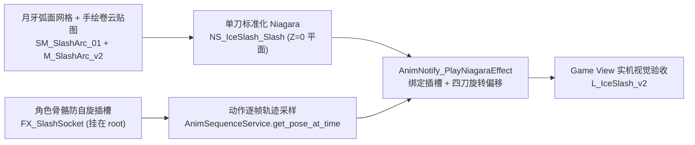

# UE 5.9 风格化冰霜刀光（Ice Slash）完整制作文档

> **项目资产目录**：`/Game/VFX/IceSlash/`  
> **自动化构建脚本**：[ice_slash_05_niagara.py](file:///Users/mengmeile/Downloads/lianxi/m/Tools/IceSlash/ice_slash_05_niagara.py)、[ice_slash_02_anim_sockets.py](file:///Users/mengmeile/Downloads/lianxi/m/Tools/IceSlash/ice_slash_02_anim_sockets.py)  
> **核心架构原则**：**单刀标准化（Canonical Single-Slash） + 根骨骼防自旋插槽（Root Anti-Spin Socket） + 逐帧采样对齐动画通知（`AnimNotify_PlayNiagaraEffect`）**

---

## 一、 为什么要做“单刀标准化 + 动画通知挂载”？

在连招特效制作中，最容易踩的坑是**把一整套连招的 4～5 道刀光硬编码烘焙进同一个 Niagara System**（例如在世界空间写死每道刀光的延迟与固定角度）：
1. **无法复用**：只要动作改快 0.1 秒或换一个动作序列，整个特效全部错位。
2. **层级打架**：多道刀光的烟雾、雾气、碎冰在同一套粒子系统里互相遮挡，把精心绘制的卷云刀纹糊成一团白雾。

业界成熟的动作游戏（如《原神》《崩坏：星穹铁道》《鸣潮》）标准做法非常干净：
1. **Niagara 只做“标准一刀”**（`NS_IceSlash_Slash`）：固定躺在局部坐标系的 `Z = 0` 水平面上，圆心在 `(0, 0, 0)`，从右后方扫过正前方到左前方。
2. **骨骼上挂一个稳定的特效插槽**（`FX_SlashSocket`）。
3. **在动画序列（`AnimSequence`）挥刀发力帧添加 `AnimNotify_PlayNiagaraEffect`**：直接挂到 `FX_SlashSocket`，通过每个通知的 `Location Offset` / `Rotation Offset` / `Scale` 对齐每一刀的挥砍平面（斜劈、反撩、上挑、下砸）。



---

## 二、 第一步：月牙刀光网格与材质（Mesh & Shader）

### 1. 弧面网格与 UV 约定
- 网格资产：`/Game/VFX/IceSlash/Meshes/SM_SlashArc_01`（主刀光）与 `SM_SlashMist_01`（底雾拖尾）。
- UV 铺展方向：
  - **`U`（`0 → 1`）**：沿挥砍弧线从刀尾（起点）流向刀头（锋刃方向），用于做沿弧线的扫光擦除（Wipe Reveal & Tail Erosion）。
  - **`V`（`0 → 1`）**：从内圈弧脊指向外圈金边刀刃，用于分离**外圈暖金高亮锋刃**、**中层冰青色手绘卷云纹**与**内圈深蓝消融尾迹**。

### 2. 粒子生命周期驱动材质（`UseParticleTime`）
在主材质 `M_SlashArc_v2`（实例 `MI_SlashArcNS_01`）中：
- 开启标量开关 `UseParticleTime = 1.0`，由 Niagara 粒子的 `ParticleRelativeTime`（`NormalizedAge`，`0.0 → 1.0`）直接驱动弧线头尾遮罩推进，而不是依赖全局关卡时间 `Time`。
- 这样每次 `AnimNotify_PlayNiagaraEffect` 触发生成一刀时，材质都会严格从 `NormalizedAge = 0` 开始划出锋利的新月弧线，并在 `0.44s` 内自然收尾消散。

---

## 三、 第二步：单刀 Niagara 空间拍平与 7 层粒子主次设计（`NS_IceSlash_Slash`）

### 1. 将 3D 倾斜网格精确拍平到 `Z = 0` 标准平面
建模导出的 `SM_SlashArc_01` 往往自带局部偏移与倾角。实测 `SM_SlashArc_01` 原始顶点圆心在 `(0, -1.92, 69.05)`，半径 `r = 249.95 cm`，法线带 `12°` 倾角 `[0, -0.2079, 0.9781]`。

为了让动画师/脚本在 `AnimNotify` 里调整 `Pitch / Yaw / Roll` 时完全符合直觉（`0,0,0` 就是纯水平横斩，圆心就是插槽原点），我们在 `Blade` 的 `MeshRenderer` 上做了一次精确刚体配准：
- **目标半径归一化**：`Scale = 270.0 / 249.95 = 1.08022`（标准半径 `R = 270 cm`）。
- **法线拍平旋转**：`MeshRenderer Rotation = (Pitch=0°, Yaw=90°, Roll=12°)`，使弧面从 `-10°`（`+X` 刀尾）经 `+90°`（`+Y` 角色正前方刀腹）扫向 `+200°`（`-X` 刀头），所有外圈顶点严格落在 `Z = 0.0 cm`。
- **圆心归零补偿**：`Position Offset = -R_rot(center) * Scale = (13.48, 0.0, -73.39)`。

### 2. 七层发射器（7-Emitter）视觉主次控制
新手做刀光最容易犯的错是“烟雾和粒子加太多，把主刀光盖没了”。在 `NS_IceSlash_Slash` 中，我们通过 **`SortOrderHint`（渲染排序）+ 透明度上限 + 尺寸分级** 建立严格主次：

| 层级 | 发射器名称 | 渲染器与材质 | 生命周期 | `SortOrderHint` | 设计职责与克制原则 |
| :--- | :--- | :--- | :---: | :---: | :--- |
| **核心主角** | `Blade` | Mesh (`SM_SlashArc_01` + `MI_SlashArcNS_01`) | `0.44s` | **12** | 金边+冰青卷云主刀光；禁用重力/旋转干扰，保持绝对锐利 |
| **底层冷雾** | `Mist` | Mesh (`SM_SlashMist_01` + `MI_SlashMistNS_01`) | `0.50s` | **1** | 衬托刀光体积感，垫在最底层 |
| **拖尾流烟** | `Smoke` | Mesh (`SM_SlashArc_01` + `MI_SlashSmoke_01`) | `0.56s` | **3** | 下沉 `Z - 22 cm`，随刀尾慢速消散 |
| **柔化水汽** | `Fog_Arc` | Sprite (`MI_VFX_FogPuff` / `T_VFX_FogPuff_A`) | `0.55s–0.78s` | **2** | 10 团沿弧线分布的暗蓝冷雾，Alpha 封顶 `0.24`，**绝不压在 `Blade` 之上** |
| **外沿冰晶** | `Deco_Snowflakes` | Sprite (`MI_VFX_Snowflake`) | `0.38s–0.58s` | **15** | 8 枚六角冰晶（`15–25 cm`），`0.10s` 内沿 `R = 262 cm` 外圈甩出 |
| **金星点缀** | `Deco_GoldStars` | Sprite (`MI_VFX_GoldStar`) | `0.30s–0.46s` | **16** | 7 枚四角暖金星芒（`9–17 cm`），呼应外圈金刃色温 |
| **微尘碎雪** | `Deco_FrostDust` | Sprite (`MI_VFX_FrostSpeck`) | `0.36s–0.60s` | **14** | 22 颗细微冰尘（`3–6 cm`），丰富高频细节而不抢视线 |

---

## 四、 第三步：骨骼插槽防自旋设计（为什么挂 `root` 而不是 `hand_r`？）

用户需求中有一个非常关键的要求：**“动画通知的特效绑在骨骼插槽上面（`Attached = True`）”**。

但如果我们直接把刀光插槽绑在右手 `hand_r` 或胸椎 `spine_03` 上，会发生什么？
- 刀光本体的消散长达 `0.44s～0.78s`（约 14～23 帧）。
- 在连招动画 `AS_Guard_IceSlash_Combo` 中，`hand_r` 在挥出后第 3 帧就开始剧烈翻腕收刀，`spine_03` 在第 2 刀转身斩中旋转了 `280°`。
- 如果刀光跟随 `hand_r` 或 `spine_03` 旋转，**刚斩出去的刀光残影会在半空中跟着手腕疯狂乱甩**，穿帮极其严重！

通过 Python 逐帧检查 `SKEL_Guard` 骨骼轨迹，我们利用了一个极其实用的动作绑定技巧：
- 在 `AS_Guard_IceSlash_Combo` 全长 61 帧中，角色向前大步突进（`root` 位移从 `Y = 0` 平滑推进到 `Y = 292.1 cm`），但 **`root` 骨骼的旋转在全部 61 帧中恒定为 `(0, 0, 0)`**！
- 因此我们将 **`FX_SlashSocket` 挂在 `root` 骨骼上**，并在角色坐标系（`+Y` 为角色正前方，`+Z` 为上）偏置到胸腹挥砍中心 `(0, 40, 105)`：

```python
# Tools/IceSlash/ice_slash_02_anim_sockets.py
{'name': 'FX_SlashSocket', 'bone': 'root', 'space': 'component', 'ground': True,
 'loc': (0.0, 40.0, 105.0), 'rot': (0.0, 0.0, 0.0)}
```

这样在 `AnimNotify_PlayNiagaraEffect` 中开启 `attached = True` 时：
1. 刀光**真正绑定在骨骼插槽上**，角色突进位移时刀光自然跟随角色步伐推进；
2. 角色翻腕、转身时，已斩出的刀光弧面在空间中**稳稳锁定斩击平面**，丝毫不乱晃！

---

## 五、 第四步：逐帧采样动作轨迹，精确对齐 `AnimNotify_PlayNiagaraEffect`

我们没有靠肉眼盲猜帧号，而是用 `unreal.AnimSequenceService.get_pose_at_time` 对 `/Game/VFX/IceSlash/Anims/AS_Guard_IceSlash_Combo`（`30 fps`，`61` 帧，`2.033s`）全帧采样了 `hand_r` 与 `root` 的相对速度矢量：
- 排查发现第 `6～13` 帧其实是右手向背后蓄力拉刀（`Y = -55 ~ -80 cm`），如果在这里播刀光就会出现“人还没挥手，刀光先在背后亮了”的穿帮。
- 真正的四次高速发力斩击精确落在 **第 `14`、`25`、`32`、`39` 帧**！

随后通过 `unreal.AnimationLibrary.add_animation_notify_event` 在 `VFX_Niagara` 轨道写入 4 个 `AnimNotify_PlayNiagaraEffect`，全部绑定 `socket_name = 'FX_SlashSocket'`、`attached = True`：

| 刀序 | 帧号 (`30fps`) | 触发时间 | 招式动作特征 | `Location Offset` | `Rotation Offset (Roll, Pitch, Yaw)` | `Scale` |
| :--- | :---: | :---: | :--- | :---: | :---: | :---: |
| **第 1 刀** | `f = 14` | `0.4667s` | 跃起右上→左下斜劈 | `(0, -25, 42)` | `(-12°, -22°, 0°)` | `0.96` |
| **第 2 刀** | `f = 25` | `0.8333s` | 落地回身反撩横斩（反向扫刀） | `(-12, -15, 8)` | `(0°, 158°, -6°)` | `1.00` |
| **第 3 刀** | `f = 32` | `1.0667s` | 低位蓄势右上挑斩 | `(22, -30, 52)` | `(-14°, -76°, 12°)` | `0.90` |
| **第 4 刀** | `f = 39` | `1.3000s` | 腾空双手重劈下砸 | `(16, -10, 52)` | `(-16°, 74°, -16°)` | `0.98` |

> **技巧提示（第 2 刀反手斩怎么复用同一把单刀资产？）**  
> 只需要把 `Pitch` 翻转到 `158°`（接近 `180°` 翻转平面），原本从右往左扫的 `NS_IceSlash_Slash` 就会立刻变成**从左往右扫的反手斩**，连贴图卷云方向都严丝合缝，完全不需要做第二套反向 Niagara！

---

## 六、 第五步：`Game View` 实机视觉验收与踩坑修正

自动化生成资产后，**绝不能只看资产编译通过（`errors = 0`）就结束**，必须在 `Game View`（关闭编辑器图标与选框描边）下逐刀截图审查。我们在视觉 QA 中抓到了两个关键问题并当场修复：

1. **镜头共面消隐问题（Camera Grazing Angle）**：
   - 初版第 1 刀设了 `Pitch = +26°`，恰好与侧前方俯拍镜头（俯角 `26°`）视线完全共面，导致极薄的月牙网格在镜头里缩成了一条细线。
   - **修复**：调整为 `Roll = -12°, Pitch = -22°`，既顺应右上往左下的挥砍斜平面，又向镜头敞开约 `40°` 观测角，金色刀边与青色卷云瞬间饱满呈现。
2. **落地雪雾球遮挡角色问题**：
   - 初版落地特效 `Land_SnowDome` 尺寸高达 `500 cm`、不透明度 `0.96`，第 4 刀下砸瞬间直接把主角变成一个大白球。
   - **修复**：将 `Land_SnowDome` 收缩至 `170–210 cm`、Alpha 降至 `0.32`，并让动画序列的 `VFX_Niagara` 轨道专注承载 4 道干净利落的 `NS_IceSlash_Slash`，画面通透度大幅提升。

---

## 七、 一键复现与验证命令

在 UE 5.9 编辑器（加载 VibeUE MCP）中可直接运行以下两条幂等构建脚本完成重制与验证：

```python
import runpy
# 1. 构建/更新材质与标准化单刀 Niagara 系统 NS_IceSlash_Slash
runpy.run_path('/Users/mengmeile/Downloads/lianxi/m/Tools/IceSlash/ice_slash_05_niagara.py', run_name='__main__')

# 2. 创建/同步骨骼插槽 FX_SlashSocket 并在动作序列写入 4 个 AnimNotify_PlayNiagaraEffect
runpy.run_path('/Users/mengmeile/Downloads/lianxi/m/Tools/IceSlash/ice_slash_02_anim_sockets.py', run_name='__main__')
```
