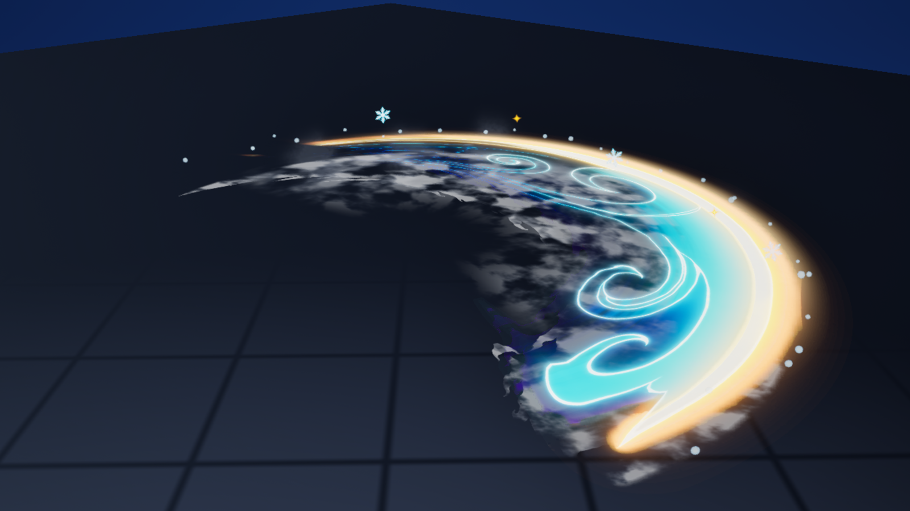
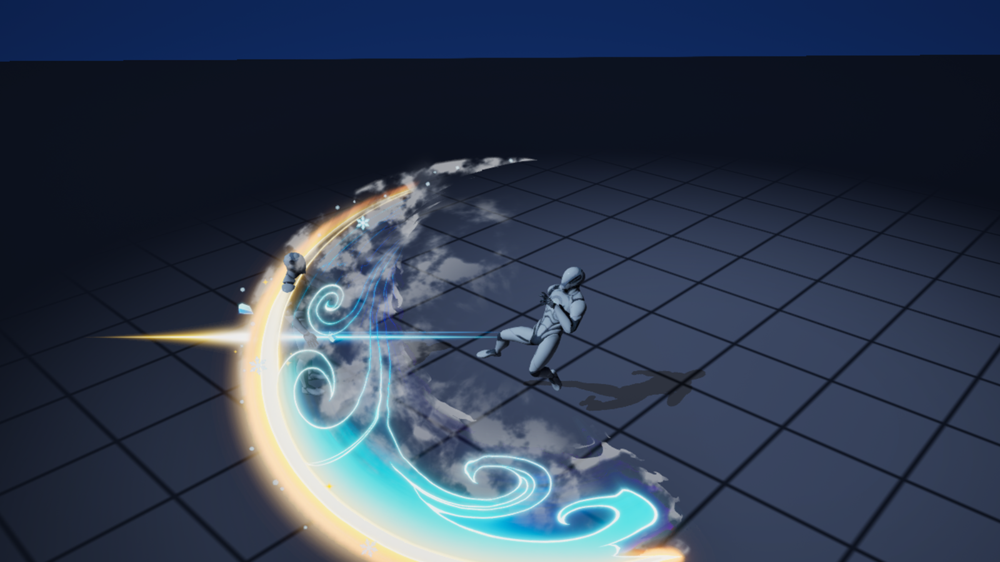
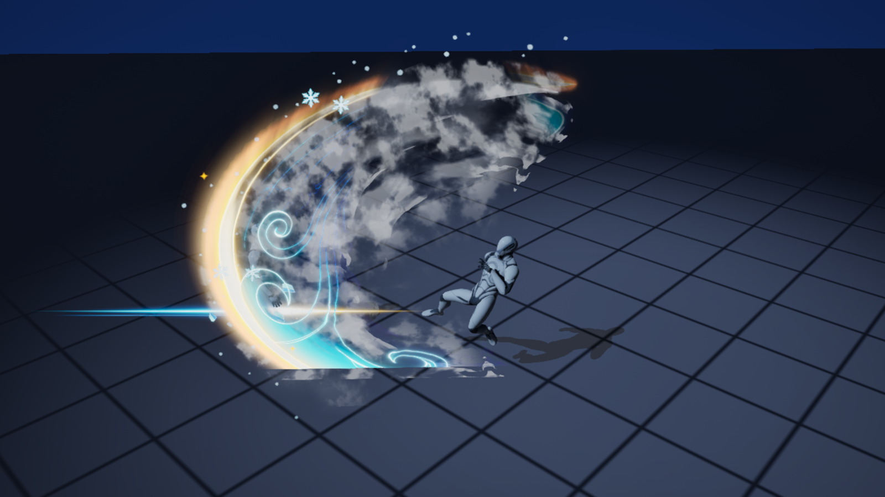
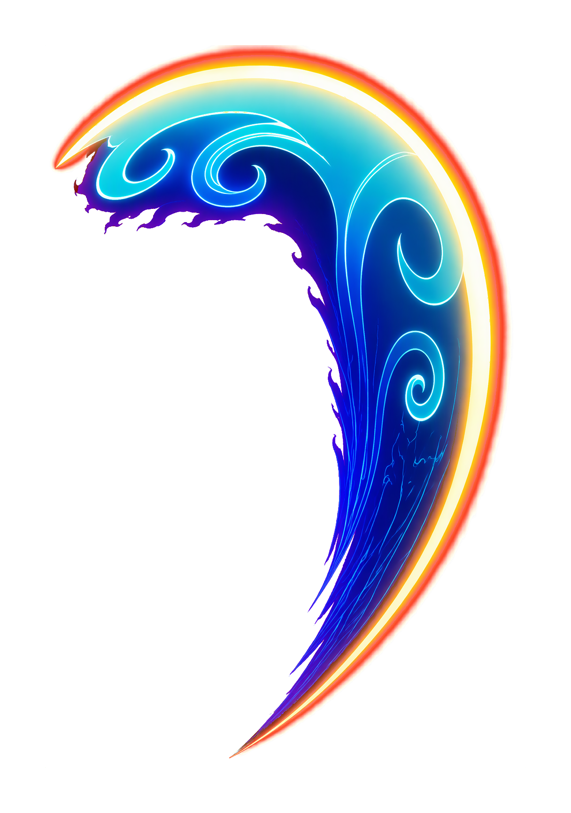
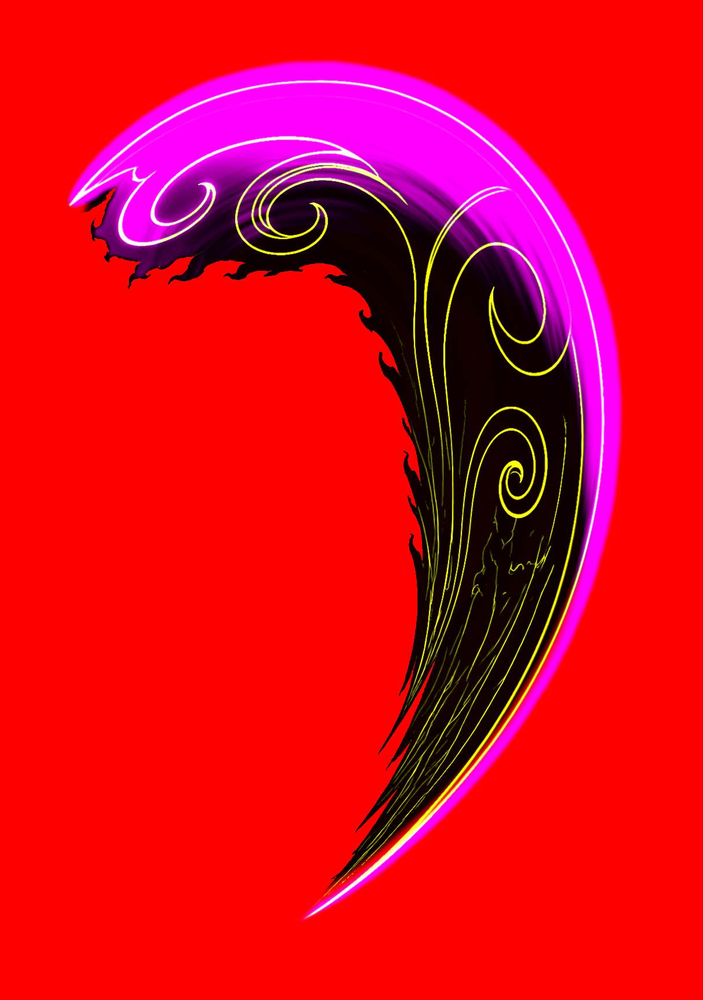
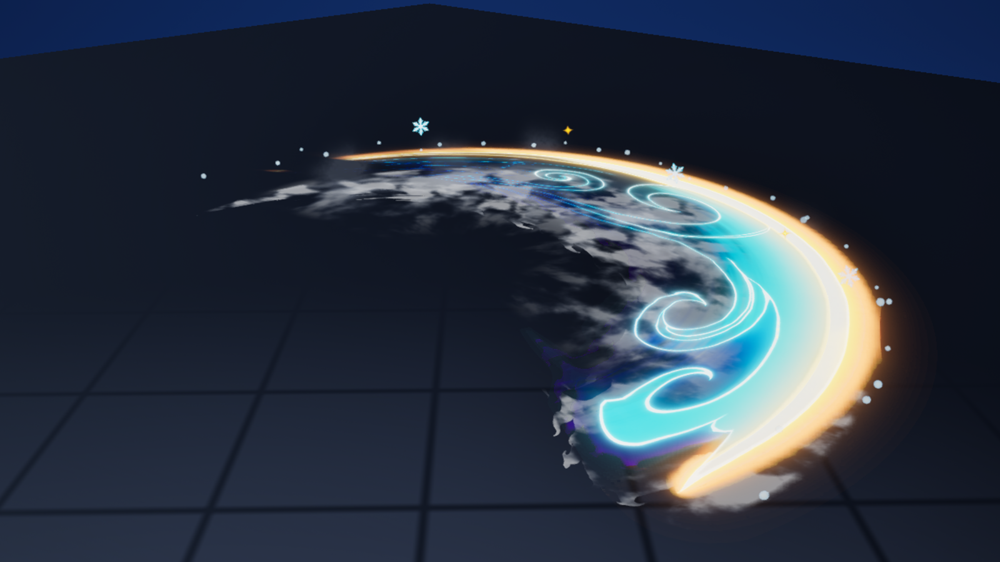
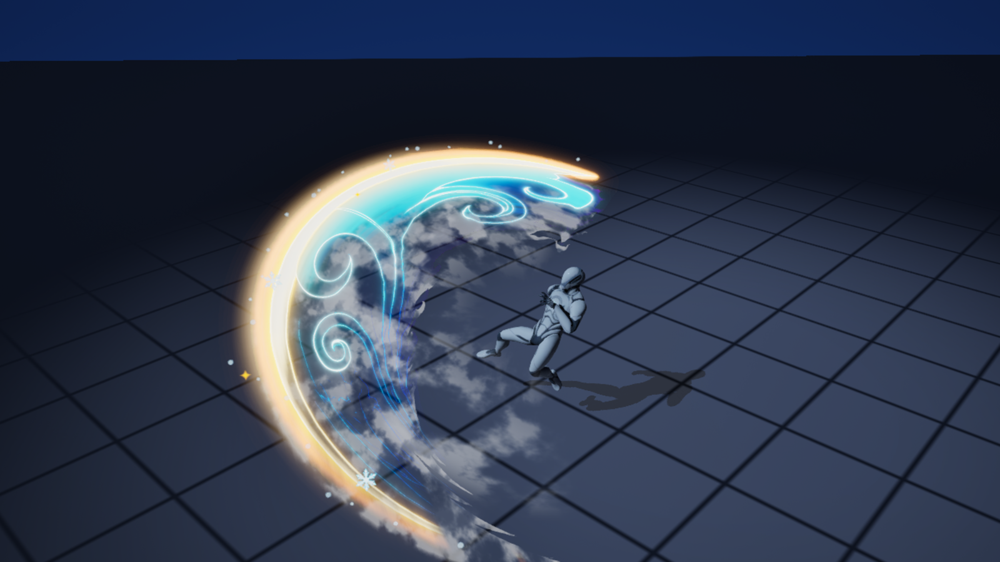
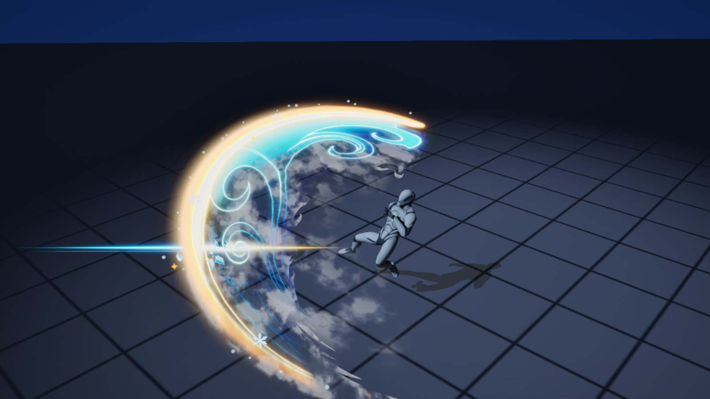
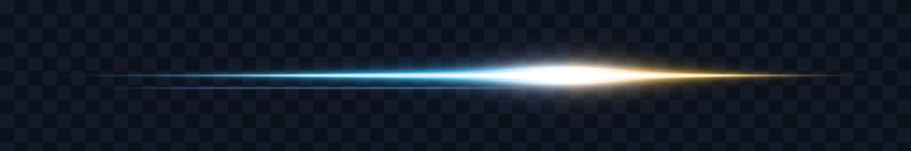

# UE5 AI 风格化冰霜金边刀光特效 — 完整源文件与 AI 对话教学工程 (UE 5.9 + VibeUE)

这是一个面向 **Unreal Engine 5.9 + AI Agent（Antigravity / Claude / Cursor + VibeUE MCP）** 的风格化动作游戏刀光特效开源教学仓库。  
无需任何商业付费贴图包，**100% 包含从纯平圆弧网格面片（`Z = 0` FBX）、程序化手绘卷浪贴图与外弧自发光贴图（PNG + Python 生成器）、UE 5.9 `.uasset` 成品资产、Niagara 叠层构建脚本，到 `root` 防甩飞骨骼插槽与四连斩绑定**的全套源文件。

👉 **新手必读图文全流程教程（含每一步直接复制给 AI 的 Prompt 话术）**：  
📖 [**Docs/01_手把手教程_怎么跟AI对话做UE5刀光特效.md**](./Docs/01_手把手教程_怎么跟AI对话做UE5刀光特效.md)

---

## ✨ 实机效果预览

| 单刀核心特写（`Z=0` 纯平面片 + 外沿 `Blade_OuterGlow` 自发光） | 四连斩实机绑定（第 1 刀斜劈） |
| :---: | :---: |
|  |  |
| **四连斩实机绑定（第 2 刀 `Pitch=158°` 自动镜像横扫）** | **四连斩实机绑定（第 4 刀跃起竖劈下砸）** |
|  |  |

🎬 **实机演示视频下载**：[`Showcase/IceSlash_Showcase.mp4`](./Showcase/IceSlash_Showcase.mp4)

---

## 🧩 特效核心拆解（面片 + 贴图 + 外弧自发光叠层）

### 1. 为什么刀光网格面片必须是 `Z = 0` 纯平面？
挥剑扫出的轨迹是一个平直切面（立体斜劈角度由旋转整块平面实现，绝不能把面片本身掰弯成香蕉曲面）。我们在 `Z = 0` 平面构建了主刀面圆弧 `SM_SlashArc_01` 与外沿窄条自发光面片 `SM_SlashOuterGlow_01`，并将 UV 按 `U=弧向(0→1)`、`V=径向(0→1)` 拉直展开：

| 主刀光纯平圆弧面片 (`SM_SlashArc_01`) | 外圈叠加窄条自发光面片 (`SM_SlashOuterGlow_01`) |
| :---: | :---: |
|  |  |

### 2. 贴在圆弧面片上的横向条带贴图
因为面片 UV 已经按极坐标拉直展开，贴图直接画成横向矩形条带，贴上面片后自动顺着圆弧弯曲：

| 主刀光手绘卷浪贴图 (`T_SlashBlade_Painted.png`) | 刀身通道遮罩 (`T_SlashBlade_BodyMask.png`) | 外围窄条自发光贴图 (`T_SlashOuterGlow`) |
| :---: | :---: | :---: |
|  |  |  |

### 3. 外围小范围窄条自发光面片（`Blade_OuterGlow`）叠加前后对比
在主刀面外圈叠一层仅约 `30 cm` 宽的低饱和度淡香槟暖米白 `BLEND_Additive` 自发光面片后，刀背外沿晕开细腻清透的空气柔光（既不过宽偏红，刀腹内部的冰青色卷浪花纹也保持 100% 清晰锐利）：

| 叠加前（仅有主刀面 `Blade`） | 叠加后（叠加 `Blade_OuterGlow` 外发光窄片） |
| :---: | :---: |
|  |  |

### 4. 独立受击贯穿横光束与切面冰晶（`NS_IceSlash_Hit` — 挥空不触发，打到人才触发）
斩击本体（`NS_IceSlash_Slash`）与受击反馈（`NS_IceSlash_Hit`）严格分离：挥空时只渲染冰霜月牙刀光；只有真正命中目标时，才沿挥砍切面生成 **“左青蓝 → 中心纯白 → 右暖金”一字尖锐贯穿横光束（`Hit_CutBeam`）+ 卡通双色切面冰晶碎块（`Hit_IceShards`）**。全场统一采用 UE5 自带 `SKM_Manny_Simple` 机器人演示，开箱即用无外部角色依赖：

| 挥空状态（无受击特效） | 命中目标状态（触发贯穿受击横光束 + 切面冰晶） | 受击横光束贴图 (`T_VFX_HitCutBeam`) |
| :---: | :---: | :---: |
|  |  |  |

---

## 📂 仓库目录结构

```text
UE5-AI-IceSlash-VFX-Tutorial/
├── Content/VFX/IceSlash/            # UE 5.9 直接可用的编译后资产 (.uasset / .umap)
│   ├── Meshes/                      # 纯平圆弧网格 SM_SlashArc_01..05 & SM_SlashOuterGlow_01..05
│   ├── Textures/                    # 刀面、遮罩、外围自发光、雪花、四角星、寒雾贴图
│   ├── Materials/                   # M_SlashArc_v2 (主刀面) & M_SlashOuterGlow (外围Additive自发光)
│   ├── Niagara/                     # NS_IceSlash_Slash (单刀本体) & NS_IceSlash_Hit (独立受击爆点)
│   ├── Anims/                       # 绑定好 FX_SlashSocket 与 4 个 AnimNotify 的连招动画
│   └── Maps/L_IceSlash_v2.umap      # 实机展示关卡
├── SourceAssets/                    # 原始 FBX 面片、PNG 贴图与 Blender/Python 生成源码
│   ├── Meshes_FBX/                  # SlashSheets_v7_ue.fbx, SlashOuterGlow_v1_ue.fbx 及单文件 FBX
│   ├── SlashTextures/               # build_flat_slash_meshes.py, gen_outer_glow_tex.py 及高清 PNG
│   ├── SlashMist/                   # 寒雾网格与贴图
│   └── VFXSprites/                  # 16px 纯透明边粒子序列贴图
├── Tools/IceSlash/                  # UE 5.9 VibeUE 全自动构建与截帧脚本 (ice_slash_01 ~ 13)
├── Skill/stylized-slash-vfx/        # 可一键安装的 AI Agent 特效技能包 (SKILL.md + 绑定模板)
├── Showcase/                        # 演示视频、实机截图、面片结构图、UE5 节点截图
└── Docs/                            # 中文保姆级图文教程与技术细节文档
```

---

## 🚀 如何在你的 UE 5.9 工程中使用？

### 方式 A：直接放入 UE 5.9 工程查看成品
1. 下载或 `git clone` 本仓库：
   ```bash
   git clone https://github.com/13660960987a-cloud/UE5-AI-IceSlash-VFX-Tutorial.git
   ```
2. 将仓库中的 `Content/VFX/IceSlash` 文件夹复制到你自己的 **UE 5.9** 工程 `Content/VFX/IceSlash` 路径下。
3. 打开编辑器即可直接查看材质 `M_SlashArc_v2` / `M_SlashOuterGlow`、粒子系统 `NS_IceSlash_Slash`（如果在空工程使用自己的角色，只需按教程在角色 `root` 骨骼建 `FX_SlashSocket` 并挂上 `NS_IceSlash_Slash` 即可）。

### 方式 B：安装 AI Skill，让你的 AI 自动帮你做刀光特效
将 `Skill/stylized-slash-vfx` 复制到你工作区的 `.agents/skills/stylized-slash-vfx`（或 Claude / Antigravity 对应技能目录），然后直接复制 [`Docs/01_手把手教程_怎么跟AI对话做UE5刀光特效.md`](./Docs/01_手把手教程_怎么跟AI对话做UE5刀光特效.md) 中的 Prompt 发给 AI 即可！
